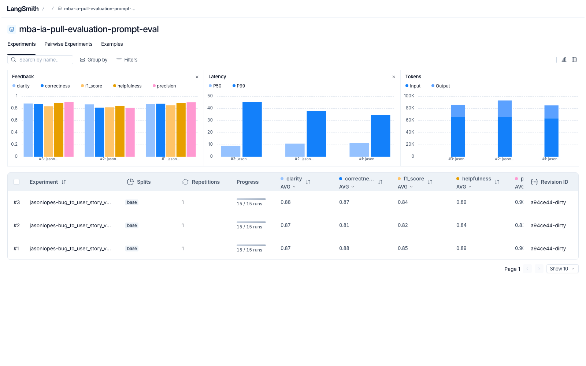
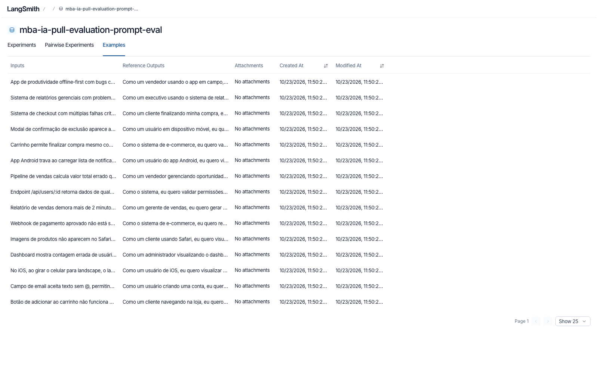
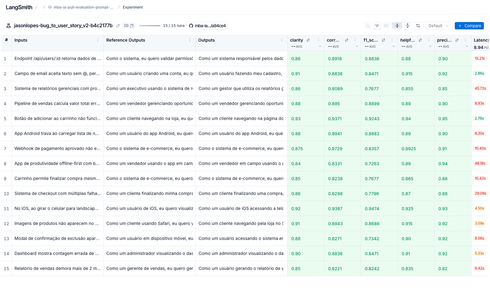
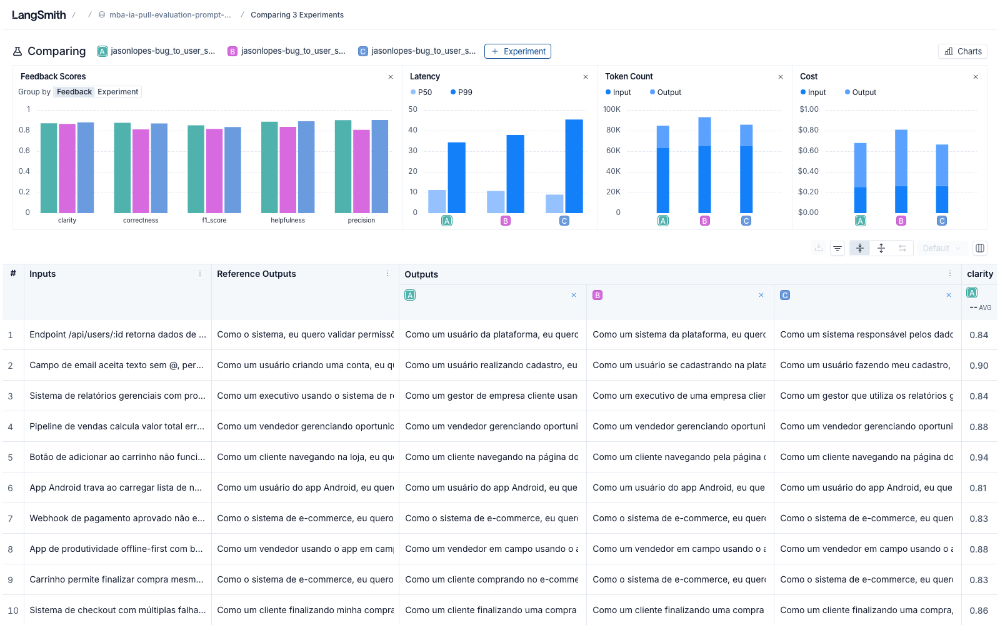
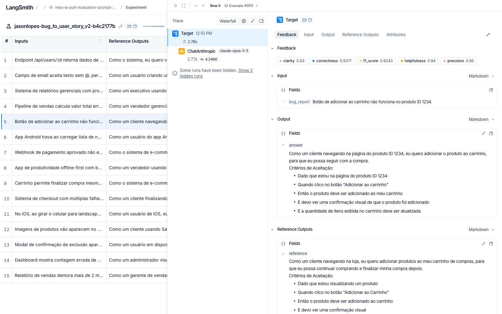
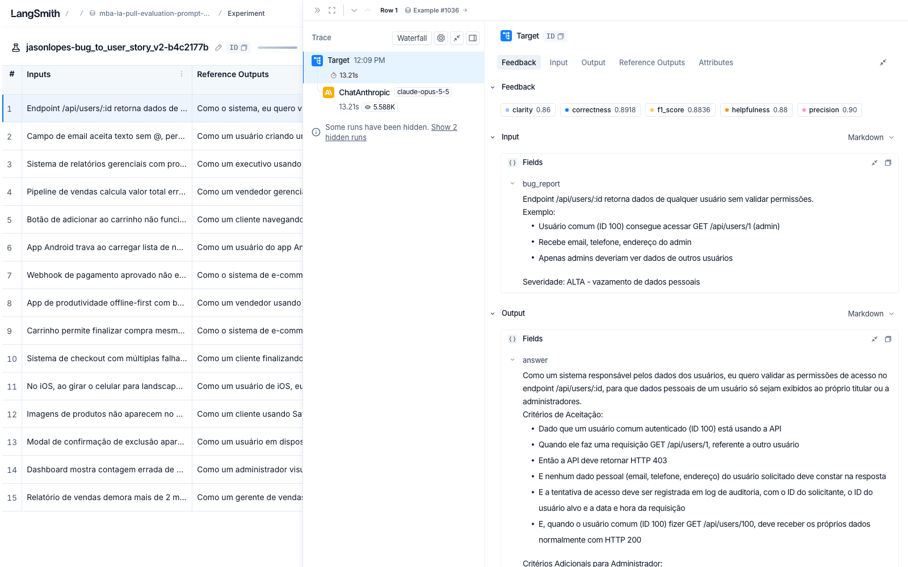
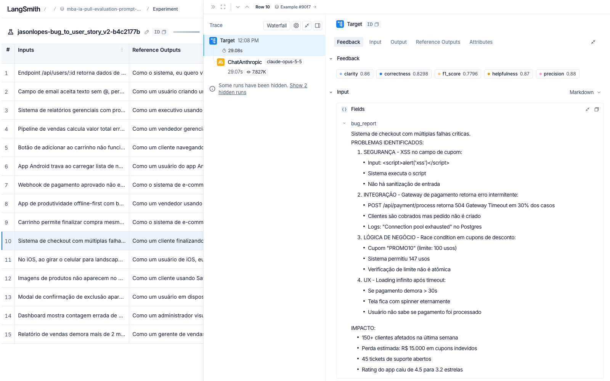

# Pull, Otimização e Avaliação de Prompts com LangChain e LangSmith

Projeto que faz **pull** de um prompt de baixa qualidade do LangSmith Prompt Hub, **refatora** o prompt com técnicas de Prompt Engineering, faz **push** da versão otimizada e **avalia** o resultado com 5 métricas (Helpfulness, Correctness, F1-Score, Clarity e Precision), exigindo nota mínima de 0.8 em todas.

> O enunciado original do desafio está em [devfullcycle/mba-ia-pull-evaluation-prompt](https://github.com/devfullcycle/mba-ia-pull-evaluation-prompt).

---

## Técnicas Aplicadas (Fase 2)

### Diagnóstico do prompt v1

| Problema na v1 | Consequência |
|---|---|
| `{bug_report}` duplicado no system e no user prompt | Ruído e desperdício de tokens; o modelo recebe o relato duas vezes |
| Persona genérica ("um assistente") | Respostas sem visão de produto nem rigor técnico |
| Nenhum formato de saída definido | Cada resposta sai com uma estrutura diferente, prejudicando Clarity e F1 |
| Sem exemplos | O modelo não sabe o nível de detalhe esperado |
| Sem regras nem tratamento de casos especiais | Invenção de dados (Precision baixa) ou omissão de problemas (Recall baixo) |

### Técnicas escolhidas

| Técnica | Por que foi escolhida | Como foi aplicada |
|---|---|---|
| **Role Prompting** | A tarefa exige a visão de quem escreve backlog: persona, valor de negócio e critérios testáveis. | "Você é um Product Manager sênior, com 10 anos de experiência em produtos digitais (e-commerce, SaaS, ERP, CRM e mobile) e forte base técnica." |
| **Few-shot Learning** (obrigatória) | É a forma mais eficiente de ensinar formato, tom e nível de detalhe. | 3 exemplos completos de entrada → saída, um para cada complexidade (simples, médio, complexo). Os exemplos usam domínios **diferentes** do dataset (editor de posts, cadastro de produtos, agendamento de consultas) para ensinar o padrão sem "vazar" respostas. |
| **Chain of Thought** (interno) | Converter bug em story exige raciocínio: quem é afetado, qual o comportamento correto, qual o benefício, qual a complexidade. | Seção "PROCESSO DE RACIOCÍNIO" com 5 passos, executados **mentalmente**. A regra 6 proíbe escrever o raciocínio na resposta, pois texto extra reduziria Precision e Clarity. |
| **Skeleton of Thought** | As referências do dataset têm tamanhos muito diferentes: bugs simples pedem 1 story + 5 critérios; bugs complexos pedem 6 seções. Um formato único erraria para mais ou para menos. | Três esqueletos de saída (SIMPLES, MÉDIO, COMPLEXO), escolhidos pelo passo 4 do raciocínio. O complexo usa as seções `=== USER STORY PRINCIPAL ===`, `=== CRITÉRIOS DE ACEITAÇÃO ===` (um bloco A, B, C... por problema), `=== CRITÉRIOS TÉCNICOS ===`, `=== CONTEXTO DO BUG ===` e `=== TASKS TÉCNICAS SUGERIDAS ===`. |

### Outros requisitos atendidos

- **System vs User Prompt:** o system prompt contém persona, processo, formato, regras e exemplos; o user prompt contém apenas a instrução curta e o `{bug_report}` (que não aparece mais duplicado).
- **Regras explícitas:** 7 regras numeradas (primeira linha obrigatória, Gherkin, critérios mensuráveis, não inventar dados, proporcionalidade, sem meta-comentários, texto simples).
- **Edge cases:** relato vago, vários problemas, segurança, cálculo, performance, relato que não é bug e relato em outro idioma.

---

## Resultados Finais

> ✅ **APROVADO** — todas as 5 métricas ≥ 0.8 nas três iterações executadas.

- **Prompt publicado (público):** https://smith.langchain.com/hub/jasonlopes/bug_to_user_story_v2
- **Dataset público com os experimentos (abre sem login):** https://smith.langchain.com/public/eb02059a-1b04-403d-a382-274bf878fffa/d
- **Modelos:** `claude-opus-5-5` para responder e para avaliar (provider `anthropic`)
- **Custo real:** US$ 0,66 a 0,81 por rodada de avaliação (≈ US$ 2,15 nas 3 iterações)

### Notas da versão final (iteração 3)

| Métrica | Nota | Status |
|---|---|---|
| Helpfulness | 0.89 | ✓ |
| Correctness | 0.87 | ✓ |
| F1-Score | 0.84 | ✓ |
| Clarity | 0.88 | ✓ |
| Precision | 0.90 | ✓ |
| **Média** | **0.88** | ✓ |

O prompt v1 não foi avaliado nesta execução (o `evaluate.py` avalia apenas o v2). Pelo diagnóstico da v1 (sem persona, sem formato, sem exemplos e com `{bug_report}` duplicado), a expectativa é de notas próximas às do exemplo do enunciado (0.45–0.52).

### Histórico de iterações

| Iteração | Mudança | Helpf. | Correct. | F1 | Clarity | Precision | Média |
|---|---|---|---|---|---|---|---|
| 1 | Versão inicial: Role + Few-shot + CoT + Skeleton of Thought | 0.89 | 0.88 | 0.85 | 0.87 | 0.90 | 0.877 |
| 2 | Trocar marcadores `[a definir]` por metas numéricas concretas; "o sistema" como persona em validações de backend | 0.84 | 0.81 | 0.82 | 0.87 | 0.81 | 0.827 |
| 3 | Equilíbrio: reaproveitar números do relato, no máximo 1 meta nova por problema (só desempenho/volume), proibir métricas inventadas e valores em aberto | 0.89 | 0.87 | 0.84 | 0.88 | 0.90 | 0.876 |

**Aprendizados**

- **Iteração 1 → 2:** o avaliador apontou marcadores sem valor (`[limite de CPU aceitável]`) como ambiguidade. A correção, "proponha metas concretas", gerou o efeito oposto: o modelo passou a inventar números (50 usuários simultâneos, CPU < 70%, 30 MB de memória), e a Precision caiu de 0.90 para 0.81 (0.60 no pior exemplo). O juiz trata número sem base no relato como alucinação.
- **Iteração 2 → 3:** a regra passou a ser restritiva e explícita (o que pode e o que não pode ser criado). A Precision voltou para 0.90 e os marcadores em aberto não reapareceram.
- **Variação entre execuções:** a API da Anthropic não aceita `temperature`, então diferenças de ±0.02 entre rodadas são ruído. A iteração 3 foi mantida como versão final por ter regras mais claras com notas equivalentes às da iteração 1.

Links dos experimentos (públicos, via dataset compartilhado):
- Iteração 1: https://smith.langchain.com/public/eb02059a-1b04-403d-a382-274bf878fffa/d/compare?selectedSessions=0e39d5e6-c30e-4c27-8d58-5ff4b8f5db6c
- Iteração 2: https://smith.langchain.com/public/eb02059a-1b04-403d-a382-274bf878fffa/d/compare?selectedSessions=7a747fde-27c9-4281-beaf-905bac74c330
- Iteração 3 (final): https://smith.langchain.com/public/eb02059a-1b04-403d-a382-274bf878fffa/d/compare?selectedSessions=3d3b2ac0-fb22-4cb9-aae2-26a71941be33

### Screenshots

**Experimentos do dataset — as 3 iterações com todas as métricas ≥ 0.8**



**Dataset de avaliação com os 15 exemplos**



**Experimento final (iteração 3) — notas por exemplo**



**Comparação lado a lado das 3 iterações (A = 1, B = 2, C = 3)**



**Tracing detalhado de 3 exemplos (entrada, saída, referência e as 5 notas)**

Exemplo simples — botão de adicionar ao carrinho (F1 0.92, Precision 0.95):



Exemplo médio — endpoint sem validação de permissões (segurança):



Exemplo complexo — checkout com 4 falhas críticas (XSS, gateway, race condition, UX):



### Comparação v1 × v2

| Aspecto | v1 | v2 |
|---|---|---|
| Persona | "assistente" genérico | Product Manager sênior com base técnica |
| Entrada | `{bug_report}` no system **e** no user | `{bug_report}` apenas no user |
| Formato | Não definido | User Story + Gherkin, com 3 esqueletos por complexidade |
| Exemplos | Nenhum | 3 (simples, médio, complexo) |
| Raciocínio | Nenhum | 5 passos internos (CoT) |
| Regras | Nenhuma | 7 regras (incluindo anti-alucinação de métricas) + 7 casos especiais |
| Metadados | Tags | Tags, versão e `techniques_applied` |

---

## Como Executar

### Pré-requisitos

- Python 3.10+ (testado com 3.13)
- Conta no [LangSmith](https://smith.langchain.com) com API Key e **handle público** criado (veja `.env.example`)
- API Key da Anthropic (provider usado neste projeto), da OpenAI **ou** do Google Gemini

### Provider Anthropic (Claude)

Este projeto usa o Claude (`LLM_PROVIDER=anthropic`, `claude-opus-5-5` para responder e avaliar). Para isso, `src/utils.py` recebeu **uma única adição**: o ramo `anthropic` em `get_llm()`, com `langchain-anthropic==1.7.4` no `requirements.txt` (a versão mais recente compatível com o `langchain-core==1.6.4` fixado). Os ramos OpenAI e Gemini, o `evaluate.py` e o `metrics.py` não foram alterados.

O ramo Anthropic não envia `temperature`: desde 21/10/2026 a API da Anthropic recusa `temperature`, `top_p` e `top_k` com HTTP 400. Por isso pequenas variações entre execuções são esperadas.

### Instalação

```bash
python3 -m venv venv
source venv/bin/activate      # Windows: venv\Scripts\activate
pip install -r requirements.txt
cp .env.example .env          # preencha as chaves, o handle e os modelos
```

### Fases

```bash
# 1. Pull do prompt original (gera prompts/bug_to_user_story_v1.yml)
python src/pull_prompts.py

# 2. Editar prompts/bug_to_user_story_v2.yml (já incluso neste repositório)

# 3. Validar o prompt localmente
pytest tests/test_prompts.py -v

# 4. Push público do prompt otimizado para {USERNAME_LANGSMITH_HUB}/bug_to_user_story_v2
python src/push_prompts.py

# 5. Avaliação (cria um experimento no LangSmith e imprime o link)
python src/evaluate.py

# 6. Gerar link público do dataset com os experimentos (rodar uma única vez)
python -c "from dotenv import load_dotenv; load_dotenv(); import os; from langsmith import Client; print(Client().share_dataset(dataset_name=os.environ['LANGSMITH_PROJECT'] + '-eval')['url'])"
```

### Estrutura

```
├── prompts/
│   ├── bug_to_user_story_v1.yml   # prompt original (pull)
│   └── bug_to_user_story_v2.yml   # prompt otimizado
├── datasets/bug_to_user_story.jsonl
├── src/
│   ├── pull_prompts.py            # pull do Hub → YAML
│   ├── push_prompts.py            # validação + push público com metadados
│   ├── evaluate.py, metrics.py, utils.py
└── tests/test_prompts.py          # 8 testes de validação do prompt
```

### Observação sobre o validador

O `validate_prompt_structure` do projeto rejeita qualquer ocorrência de `TODO`, inclusive dentro da palavra "TODOS". Por isso o prompt v2 evita essa palavra.
